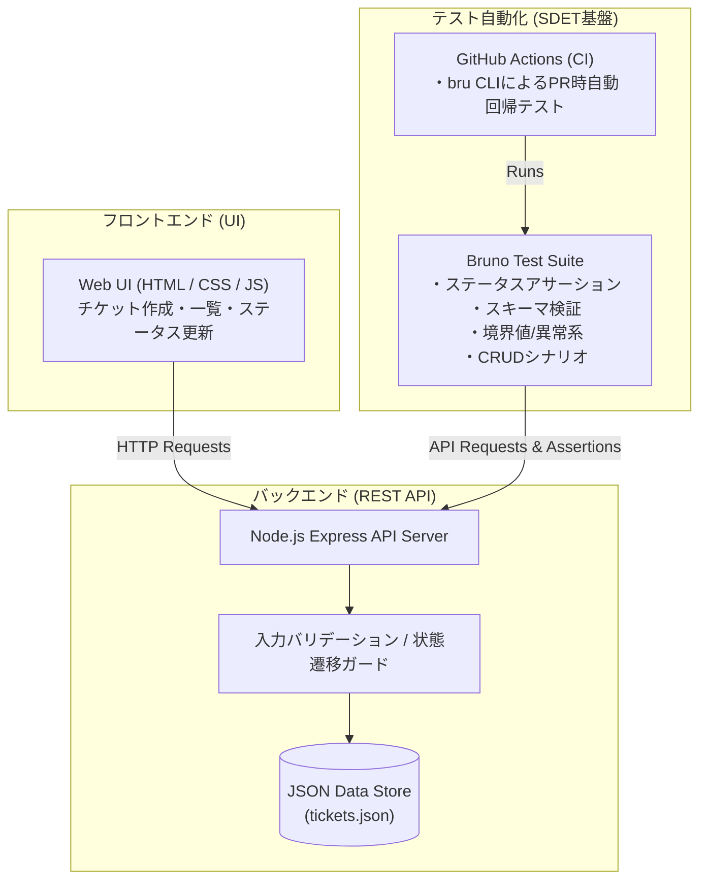

# QA Tracker & API Automated Test Suite

## 概要
実務における **Azure DevOps（Boards / Test Plans）** でのテストケース管理・ステータス運用と、**Bruno** を用いたAPI自動回帰テスト（リグレッションテスト・アサーション）の実務知見を元に設計・開発した「QAトラッキングシステム」および「API自動テスト基盤」です。

本プロジェクトは、単なるWebアプリケーションの作成にとどまらず、**SDET（Software Development Engineer in Test / テスト開発エンジニア）** の視点から、**「テスト容易性（Testability）の高いAPI設計」** と **「Brunoを活用した実践的な自動テスト設計・CI連携」** をゼロから体現することを目的としています。

---

## SDETとしての開発動機・背景

前職ではテストリードとして以下の業務を担当していました：
- **Azure DevOps** を用いたテストケースのレビュー、インポート、実行結果およびステータス管理
- **Bruno** を用いたAPIリグレッションテストの運用およびアサーションによる合否検証

従来の業務では用意されたテスト環境・APIに対してテストを実行していましたが、**「裏側でAPIやデータがどのように連携し、どう設計すればよりテストしやすく堅牢なシステムになるのか？」** を根本から理解し、開発と品質保証の架け橋となるエンジニア（SDET）を目指すため、本システムを設計・構築しました。

---

## システムアーキテクチャ



---

## ディレクトリ構成

```text
qa-tracker/
├── docs/                     # 設計・仕様・テスト戦略ドキュメント
│   ├── requirements.md       # 要件定義書（Azureの知見を反映した業務要件）
│   ├── basic-design.md       # 基本設計書（APIエンドポイント、データモデル、状態遷移）
│   └── test-strategy.md      # テスト戦略書（Brunoアサーション設計、テスト観点表）
│
├── server/                   # バックエンド（RESTful API）
│   ├── server.js             # APIサーバー実装
│   └── data/                 # データ保存領域
│
├── public/                   # フロントエンド（Web UI）
│   ├── index.html            # メイン画面
│   ├── css/style.css         # UIスタイル
│   └── js/app.js             # UIロジック
│
└── bruno/                    # Bruno APIテストコレクション
    ├── bruno.json            # コレクション設定
    └── (各APIテストスクリプト)
```

---

## ドキュメント一覧

- [要件定義書 (docs/requirements.md)](file:///C:/Users/owner/Projects/qa-tracker/docs/requirements.md)
- [基本設計書 (docs/basic-design.md)](file:///C:/Users/owner/Projects/qa-tracker/docs/basic-design.md)
- [テスト戦略・アサーション設計書 (docs/test-strategy.md)](file:///C:/Users/owner/Projects/qa-tracker/docs/test-strategy.md)
