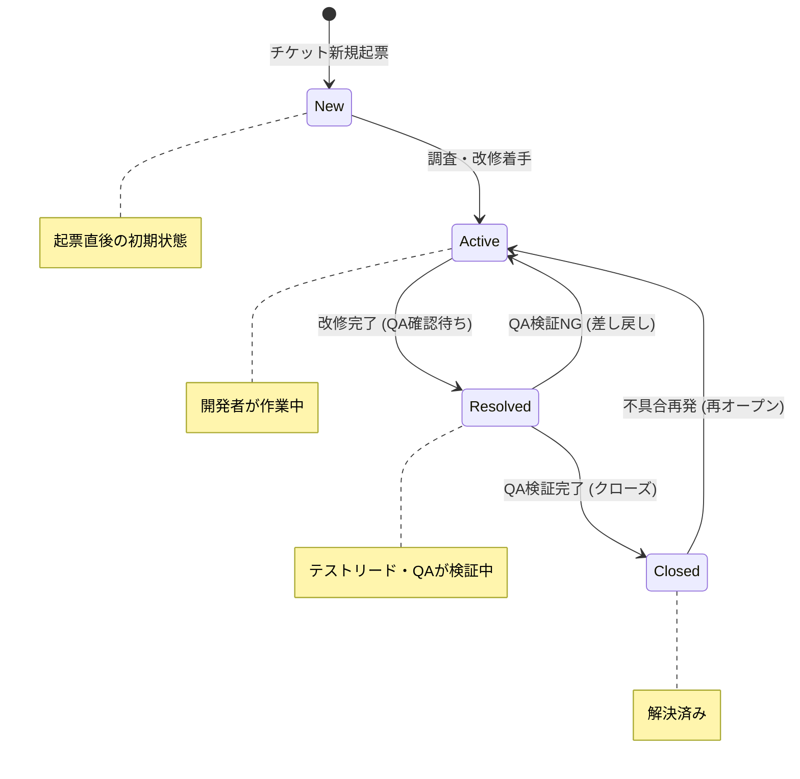

# 基本設計書 (Basic Design Specification)

## 1. システム構成概要

本システムは、軽量かつ依存関係を最小限に抑えた構成を採用しています。
ローカル環境およびCI環境（GitHub Actions）で即座に起動し、Brunoから高速にテストを実行できるように設計しています。

* **フロントエンド**: HTML5, CSS3, Vanilla JavaScript（Fetch APIでバックエンド通信）
* **バックエンド**: Node.js + Express
* **データ永続化**: JSONファイル（`server/data/tickets.json`）※モック/軽量DBとして機能
* **テスト環境**: Bruno (コレクション管理・アサーション)

---

## 2. データモデル設計

### 2.1 チケットエンティティ (Ticket)

| フィールド名 | 型 | 必須 | 初期値 | 説明 | 例 |
| :--- | :--- | :---: | :--- | :--- | :--- |
| `id` | String | ○ | 自動採番 | 一意のチケット識別子 (UUIDまたはタイムスタンプ) | `"t-1715000000"` |
| `title` | String | ○ | - | 不具合の要約 (1〜100文字) | `"ログインボタン押下時に401エラーが発生する"` |
| `reproductionSteps`| String | ○ | - | 再現手順 | `"1. ログイン画面を開く\n2. 資格情報を入力"` |
| `expectedResult` | String | ○ | - | 期待される正常動作 | `"ダッシュボード画面へ遷移すること"` |
| `actualResult` | String | ○ | - | 実際の挙動 | `"エラーアラートが表示され遷移しない"` |
| `priority` | String | ○ | `"Medium"` | 優先度 (`Low`, `Medium`, `High`, `Critical`) | `"High"` |
| `severity` | String | ○ | `"Major"` | 重大度 (`Minor`, `Major`, `Critical`, `Blocker`) | `"Critical"` |
| `status` | String | ○ | `"New"` | ステータス (`New`, `Active`, `Resolved`, `Closed`) | `"New"` |
| `createdAt` | String | ○ | 現在日時 | 作成日時 (ISO 8601形式) | `"2026-11-15T14:00:00.000Z"` |
| `updatedAt` | String | ○ | 現在日時 | 更新日時 (ISO 8601形式) | `"2026-11-15T14:00:00.000Z"` |

---

## 3. ステータス遷移設計

Azure DevOpsの実務運用思想を踏まえ、不正な遷移を防止するステートマシンを設計しています。



### 遷移可否マトリクス

| 現在のステータス \ 変更先 | `New` | `Active` | `Resolved` | `Closed` |
| :--- | :---: | :---: | :---: | :---: |
| **`New`** | - | ○ (着手) | × | × |
| **`Active`** | × | - | ○ (改修完了) | × |
| **`Resolved`** | × | ○ (差し戻し) | - | ○ (クローズ) |
| **`Closed`** | × | ○ (再発) | × | - |

※ × の遷移を要求された場合、APIは `400 Bad Request` とエラーメッセージを返却します。

---

## 4. RESTful API エンドポイント設計

すべてのAPIは JSON フォーマットで送受信を行います。

### 4.1 エンドポイント一覧

| Method | エンドポイント | 説明 | 成功ステータス |
| :--- | :--- | :--- | :---: |
| `GET` | `/api/tickets` | チケット一覧取得（クエリパラメータで絞り込み可） | `200 OK` |
| `GET` | `/api/tickets/:id` | チケット詳細取得 | `200 OK` |
| `POST` | `/api/tickets` | チケット新規作成 | `201 Created` |
| `PATCH` | `/api/tickets/:id/status` | チケットのステータス更新 | `200 OK` |
| `DELETE` | `/api/tickets/:id` | チケット削除 | `200 OK` |

---

### 4.2 各APIの詳細仕様

#### ① チケット新規作成: `POST /api/tickets`
* **Request Body**:
```json
{
  "title": "ログインボタン押下時に401エラーが発生する",
  "reproductionSteps": "1. ログイン画面を開く\n2. ID/PWを入力して送信",
  "expectedResult": "ダッシュボードに遷移すること",
  "actualResult": "画面が遷移せずエラーが表示される",
  "priority": "High",
  "severity": "Critical"
}
```
* **Response (201 Created)**:
```json
{
  "success": true,
  "data": {
    "id": "t-1715000000",
    "title": "ログインボタン押下時に401エラーが発生する",
    "reproductionSteps": "1. ログイン画面を開く\n2. ID/PWを入力して送信",
    "expectedResult": "ダッシュボードに遷移すること",
    "actualResult": "画面が遷移せずエラーが表示される",
    "priority": "High",
    "severity": "Critical",
    "status": "New",
    "createdAt": "2026-11-15T14:00:00.000Z",
    "updatedAt": "2026-11-15T14:00:00.000Z"
  }
}
```

#### ② ステータス更新: `PATCH /api/tickets/:id/status`
* **Request Body**:
```json
{
  "status": "Active"
}
```
* **Response (200 OK)**:
```json
{
  "success": true,
  "data": {
    "id": "t-1715000000",
    "status": "Active",
    "updatedAt": "2026-11-15T14:05:00.000Z"
  }
}
```

---

## 5. 統一エラーハンドリング仕様（テスト容易性の担保）

APIエラーが発生した際、Brunoのアサーションで検証しやすいようにエラーレスポンスの構造を全APIで統一します。

* **Response (400 Bad Request / 404 Not Found)**:
```json
{
  "success": false,
  "error": {
    "code": "INVALID_STATUS_TRANSITION",
    "message": "Cannot transition status from 'New' to 'Closed'. Allowed transitions: Active",
    "field": "status"
  }
}
```
これにより、Brunoでは `res.body.error.code` や `res.body.success === false` を正確にアサーションできるようになります。
