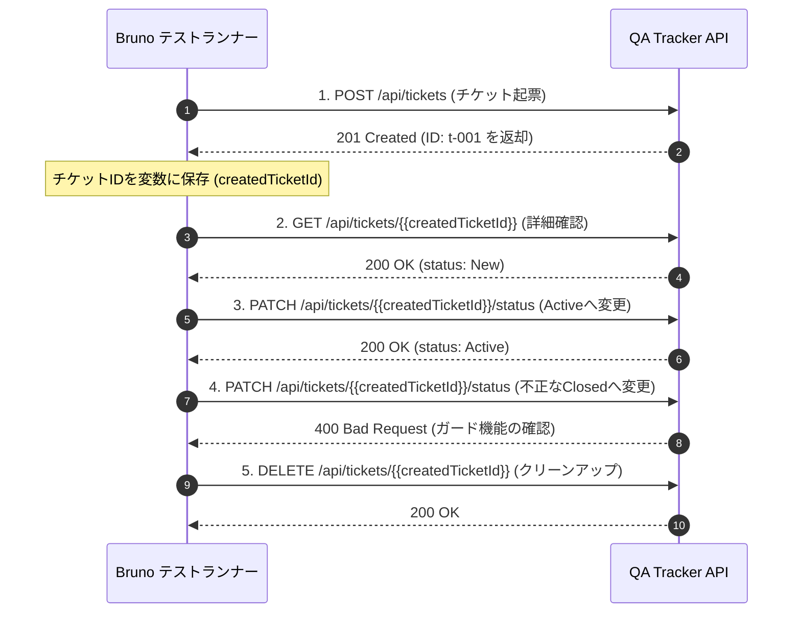

# テスト戦略・アサーション設計書 (Test Strategy & Assertion Design)

## 1. テスト方針 (Testing Policy & SDET Approach)

### 1.1 テストピラミッドと自動化スコープの選定
本プロジェクトでは、テストの保守コストと実行速度のバランス（ROI: 投資対効果）を最大化するため、**API（サービス）レイヤーにおける自動回帰テスト** に注力します。

```text
       ▲
      / \        [ E2E / UIテスト ] (一部を手動検証・クリティカルパスのみ)
     /   \
    /     \      [ API自動テスト (Bruno) ] ★本プロジェクトの主注力領域
   /───────\     ・高実行速度、低フレーキー（壊れにくさ）
  /         \    ・ビジネスロジック・境界値・スキーマを網羅
 /           \
/─────────────\  [ 単体テスト (Unit Test) ]
```

* **UIテスト（手動）**: 画面の見栄え、フォント、操作感などのUX評価
* **APIテスト（Brunoで完全自動化）**: データ整合性、ステータス遷移制御、バリデーション、エラーハンドリング

---

## 2. テスト観点表 (Test Matrix)

前職のテストリード経験（テストケース設計・観点洗い出し）を活かし、網羅的なテスト観点を定義します。

| カテゴリ | 観点 | テスト内容 | 期待結果 (アサーション) |
| :--- | :--- | :--- | :--- |
| **正常系** | チケット起票 | 有効なパラメータでPOST | 201 Created, IDが付与され status が `"New"` |
| **正常系** | 一覧・詳細取得 | 登録済みデータのGET | 200 OK, 配列または指定IDのオブジェクトが返却 |
| **正常系** | ステータス更新 | `New` ➔ `Active` への更新 | 200 OK, status が `"Active"` に変更される |
| **正常系** | ステータスサイクル | `Active` ➔ `Resolved` ➔ `Closed` | 各段階で 200 OK, status が正しく遷移する |
| **正常系** | チケット削除 | 登録済みデータのDELETE | 200 OK, その後のGETで404が返却される |
| **異常系** | 必須項目欠落 | `title` なしでPOST | 400 Bad Request, エラーメッセージに欠落項目明記 |
| **異常系** | 境界値超過 | 101文字以上の `title` でPOST | 400 Bad Request |
| **異常系** | 不正ステータス遷移 | `New` からいきなり `Closed` に更新 | 400 Bad Request, 不正遷移コードが返却 |
| **異常系** | 存在しないデータ | 存在しないIDへのGET / PATCH / DELETE | 404 Not Found, 共通エラーフォーマット |

---

## 3. Brunoにおけるアサーション設計

Brunoの `assert` 機能および `tests` スクリプトブロックを活用し、以下の多層的なアサーションを実装します。

### 3.1 アサーションの4大階層
1. **HTTPステータスコード検証**: `res.status === 201`
2. **レスポンスタイム検証**: `res.responseTime < 500` (パフォーマンスの担保)
3. **データ構造・スキーマ検証**: 必須キー（`id`, `title`, `status`, `createdAt`）の存在と型
4. **ビジネスロジック値検証**: 指定したステータスや値が意図通り反映されているか

### 3.2 Brunoスクリプト実装例

#### 例1: チケット新規作成の Bruno 定義 (`POST_create_ticket.bru`)
```javascript
// Bruno Script (assert)
assert {
  res.status: eq 201
  res.responseTime: lt 500
  res.body.success: isTrue
  res.body.data.id: isDefined
  res.body.data.status: eq "New"
}

// Bruno Script (tests - 詳細ロジック・変数保持)
tests {
  test("IDが採番され、環境変数に保持されること", function() {
    const data = res.getBody().data;
    expect(data.id).to.be.a('string');
    // 次のリクエスト（更新・削除）へIDを引き継ぐ
    bru.setEnvVar("createdTicketId", data.id);
  });
}
```

#### 例2: 不正ステータス遷移の拒否テスト (`PATCH_invalid_transition.bru`)
```javascript
// Bruno Script (assert)
assert {
  res.status: eq 400
  res.body.success: isFalse
  res.body.error.code: eq "INVALID_STATUS_TRANSITION"
}
```

---

## 4. リクエストチェーン・シナリオテスト（E2E APIテスト）

前職のリグレッションテスト運用を再現し、単発のリクエストだけでなく、**「一連の業務フローが破綻なく動作するか」** を検証するチェーンテストを構築します。



---

## 5. CI/CD 連携計画 (GitHub Actions)

ローカルでの手動実行にとどまらず、コード変更時に自動でテストが実行されるCI環境を構築します。

* **使用ツール**: Bruno CLI (`@usebruno/cli`)
* **トリガー**: `main` ブランチへのプルリクエスト作成時
* **実行内容**:
  1. サーバーのバックグラウンド起動
  2. `bru run --env local` でテストコレクション全件実行
  3. テスト合否結果のレポート出力
